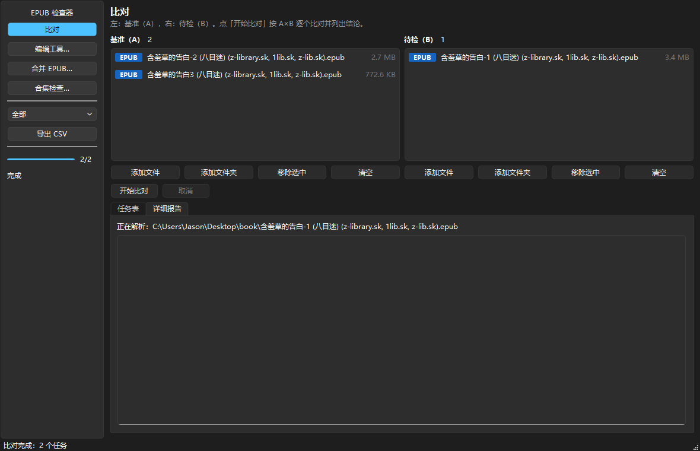

# EPUB 检查器

一个给「囤书党」用的 Windows 桌面工具：**批量比对电子书**、**编辑 EPUB 目录与封面**、**合并多本 EPUB**、**合集与分册内容核查**。

界面基于 PySide6（Qt），核心逻辑是纯 Python，不依赖任何电子书软件。



## 功能

### 1. 批量比对（A × B）

- 左侧「基准（A）」、右侧「待检（B）」，两边各自拖入或添加文件／文件夹，按 **A×B 全组合**逐个比对并列出结论。
- 支持格式：`EPUB`、`MOBI`、`AZW`、`AZW3`、`PRC`、`PDF`。
- 两类比对：
  - **文本层**：按资源路径配对，路径对不上再按内容哈希配对，算内容覆盖率；
  - **页面图自动回退**：两侧都没有有意义的文字（比如扫描版 PDF 对图片版 EPUB）时，自动改按页面图指纹（dHash + 灰度 MAD）一对一配对。2147 页的书约 4 秒（并行解图 + 本地缓存，第二次秒开）。
- 结论分八档：`✓ 一致`、`≈ 合集内含（内容一致）`、`~ 部分一致`、`✗ 存在差异`、`⛔ 无法比对`、`失败`、`已取消`、`跳过`。
- 任务表支持按列排序、按结论过滤；双击任意行查看该书的详情报告与逐条差异；可导出 CSV（UTF-8 BOM，Excel 直接打开）。

### 2. 编辑工具（只针对 EPUB）

- **目录检查**：同时看「书自身的目录结构」和「与你的章节清单的差异」。
- **目录生成**：按清单重写 `nav.xhtml` + `toc.ncx`（双写），自动配对章节文件，**另存新文件**，写完自检。
- **封面**：大预览、可拖图，超过 2000px 自动缩到 1600；原书已有封面会先问你要不要替换；同样**另存新文件**。
- **修复重复目录项**：折叠「父项与唯一子项同标题同链接」的重复条目（合并书常见），顺手重排 `playOrder`。

### 3. 合并 EPUB

- 多本按自然序（`Vol.2` 在 `Vol.10` 前面）合并成一册，各书原封不动放进 `book_001/`…，顶层重建 `package.opf` + 双层 `nav.xhtml`/`toc.ncx`。
- 封面三态：取第一本自带封面 / 不要封面 / 指定图片。
- 先写 `.part`、自检通过再 `os.replace`，失败不留半成品。

### 4. 合集检查

- 给定「整本合集」与若干「分册」，检查分册内容是否都在合集里，报告**缺失页**、**疑似降质页**、**合集里多出来的重复页**。

### 通用

- 四个功能各占一个页签，侧栏切换；对比页、编辑页、合并页、合集页**都支持把文件/文件夹拖进来**。
- 记住窗口大小、列宽、上次浏览目录；设置写在程序目录的 `epub_checker.ini`（不碰注册表）。

## 下载与运行

- **不想装 Python**：到 [Releases](../../releases) 下载 `EPUB检查器.exe`，双击即用（单文件，首次启动稍慢）。
- **从源码运行**：

```bash
pip install -r requirements.txt
python epub_checker_app.py
```

要求 Windows 10/11 + Python 3.10+（开发环境 3.12）。

## 从源码打包 exe

```bash
pip install pyinstaller
python -m PyInstaller epub_checker.spec --noconfirm
# 产物：dist/EPUB检查器.exe
```

也可以直接双击 `打包exe.bat`。打包后自检：

```bash
dist\EPUB检查器.exe --smoke
# 正常输出：SMOKE OK gui=<版本> core=<版本> mode=offscreen
```

## 项目结构

```
epub_parse.py        解析层：zip / OPF / spine / nav / ncx / mobi / pdf / 图片指纹
epub_check.py        检查比对：单书体检、两书比对、合集检查、页面图匹配、任务调度
epub_edit.py         编辑合并：目录清单、生成 nav+ncx、改 OPF、写包、封面、合并、修重复
epub_core.py         门面：把上面三层的名字汇总导出
epub_gui_qt.py       PySide6 界面
epub_checker_app.py  入口（支持 --smoke 自检）
epub_checker.spec    PyInstaller 配置
打包exe.bat          一键打包
epub_checker.bat     源码方式启动
docs/                使用说明、交接文档、测试与审查报告、截图
```

依赖方向：`epub_parse` ← `epub_check` ← `epub_edit`，`epub_core` 只做汇总，没有循环依赖。

## 已知限制

- **逐字**比对只支持有文字层的 EPUB；扫描版 PDF / 图片版 EPUB 走页面图比对（比的是版式，不是文字）。
- 文字版 MOBI/AZW3 的「逐字」比对未实现。
- 单文件多锚点（`#filepos`）的目录重建未实现。
- DRM 加密的 EPUB 会在解析阶段直接报错，不做解密。
- 只在 Windows 上验证过。

## 许可证

**禁止商用**：个人学习、自用、非商业分发都可以；任何商业用途需先获得作者书面许可。详见 [LICENSE](LICENSE)。

## 免责声明

本工具只读写你自己提供的文件；编辑/合并类功能**永远另存新文件**，不会覆盖原书。但任何自动化处理都有出错可能，重要藏书请自行备份。
